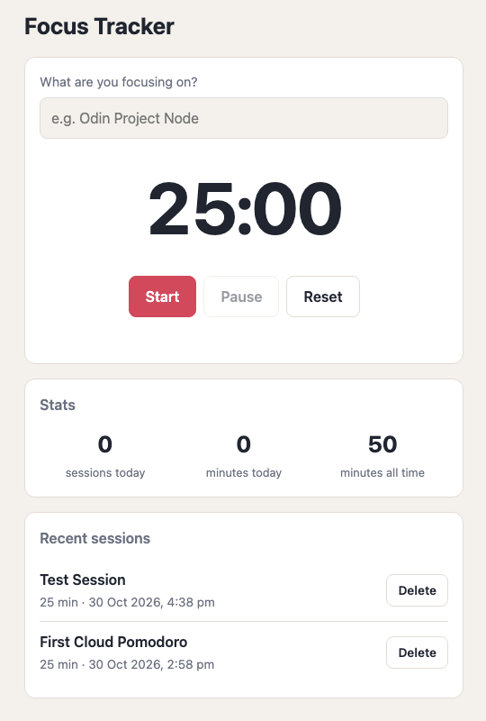

# Focus Tracker ⏱️

A Pomodoro timer that saves every finished focus session to PostgreSQL and shows how much you focused today. Built with Express and a small REST API; the browser talks to the API with `fetch`.

🔗 **[Live Demo](https://focus-tracker-2ooe.onrender.com)** *(free hosting: the first load can take 30–60 seconds while the server wakes up)*

<p align="center">
  <picture>
    <source media="(prefers-color-scheme: dark)" srcset="docs/screenshot-dark.png">
    
  </picture>
</p>

---

## Features

- **25-minute focus timer** with Start, Pause/Resume and Reset. The countdown also shows in the browser tab.
- **Sessions saved automatically** when the timer finishes (`POST /api/sessions`).
- **Recent sessions** list with delete, and **stats** for today and all time.
- **Accurate on phones:** the timer counts down to a fixed end time, so it stays correct even when the phone slows down a background tab.
- **Validation on the server and in the database:** labels must be 1–60 characters and minutes 1–180; bad input gets a `400` with a clear message.
- **"Today" means today in Brisbane:** the database runs in UTC, so stats convert to `Australia/Brisbane` first.
- Light and dark mode, sized for phones.

---

## Tech Stack

| Area | Tools |
|---|---|
| Server | Node.js 20+, Express 5, EJS |
| Database | PostgreSQL on [Neon](https://neon.tech), `pg` driver |
| Frontend | HTML, CSS, vanilla JavaScript (`fetch`) |
| Hosting | Render (free web service) |

---

## API

| Method | Path | What it does |
|---|---|---|
| `GET` | `/api/sessions` | Latest 50 sessions, newest first |
| `POST` | `/api/sessions` | Create a session. Body: `{ "label": "Odin Project", "minutes": 25 }`. Returns `201` with the new session, or `400` with `errors` |
| `DELETE` | `/api/sessions/:id` | Delete a session. `204` on success, `404` if it doesn't exist |
| `GET` | `/api/stats` | `{ today: { count, total_minutes }, allTime: { count, total_minutes } }` |
| `GET` | `/api/health` | `{ ok: true }` |

All queries use parameters (`$1`, `$2`), never string concatenation, so user input can't change the SQL.

---

## Run it locally

**Needs:** Node.js 20 or newer and a PostgreSQL database (a free [Neon](https://neon.tech) project works).

```bash
git clone https://github.com/vy-trg/focus-tracker.git
cd focus-tracker
npm install
cp .env.example .env
```

1. Put your connection string in `.env`: `DATABASE_URL=postgresql://...`
2. Create the table: run `db/schema.sql` once in the Neon SQL Editor.
3. Check the connection: `npm run test-db`
4. Start the app: `npm run dev`, then open http://localhost:3000

**Testing tip:** set `FOCUS_SECONDS` in `public/timer.js` to `10` so you don't wait 25 minutes. Set it back before committing.

---

## Project structure

```
app.js            Express app: routes, validation, API
db/pool.js        PostgreSQL connection pool (SSL for Neon)
db/queries.js     All SQL queries
db/schema.sql     Table definition with CHECK constraints
views/index.ejs   Page layout
public/timer.js   Timer and API calls in the browser
public/style.css  Styles (light + dark)
scripts/test-db.js  Checks the database connection
```

---

## What I learned

- Designing a small REST API and returning the right status codes (`201`, `204`, `400`, `404`).
- Validating input twice: in Express for clear error messages, and with `CHECK` constraints so the database never stores bad data.
- Time zones: storing `TIMESTAMPTZ` in UTC and converting to Brisbane time when counting "today".
- Why `setInterval` timers drift on phones, and how counting to an end time fixes it.
- Deploying to Render with the database URL as an environment variable, never in the repo.
