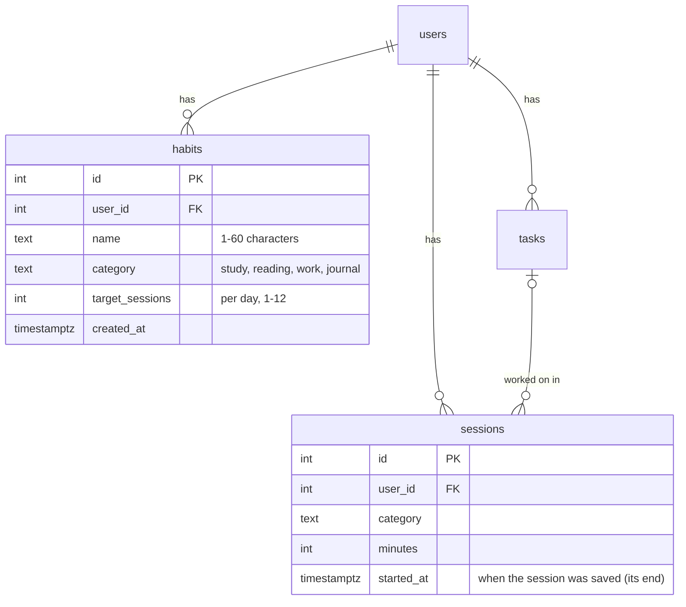

# Habits (Focus Tracker v3)

## The problem

Habit apps make you tick a box every day, so it's easy to stop. Focus Tracker already knows what you studied, read and worked on. A habit like "2 study sessions a day" can tick itself from the sessions you finish.

## Data

A habit stores **no** daily ticks. Whether today is done is worked out from `sessions`:
count today's sessions (Brisbane time) with the habit's category, and compare with `target_sessions`.
So there is nothing to forget, and deleting a session updates the habit too.

## Plan

| Day | What |
|---|---|
| Mon 9 Nov | `habits` table (migration 003), `GET/POST /api/habits`, `PATCH/DELETE /api/habits/:id`, every query filtered by `user_id` |
| Tue 10 Nov | Done today, worked out from sessions; habit streak function with tests (first day, a missed day, across midnight) |
| Wed 11 Nov | Habits on the page: today's progress, last 7 days as dots, streak |

## Decisions

| Decision | Why |
|---|---|
| No `habit_checks` table | A tick is derived from sessions, so it can't disagree with them |
| One category per habit | Matches how sessions are tagged; "2 study sessions" is clear |
| `target_sessions` is sessions, not minutes | A 15-minute and a 90-minute preset both count as one sitting; minutes could come later |
| `ON DELETE CASCADE` from users | Deleting an account removes its habits |
