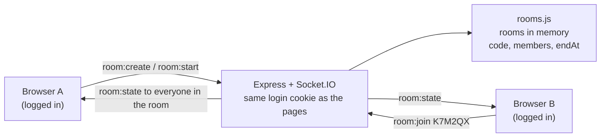

# Study rooms (body doubling)

## The problem

Studying alone makes it easy to put things off. Studying "together" with a friend, even remotely and in silence, helps people start and keep going (body doubling). Focus Tracker had no way to share a timer.

## How it works

- **Socket.IO** runs on the same http server as the pages. It reads the same login cookie (express-session + passport), so only logged-in people can connect; anyone else gets *Log in to use study rooms*.
- **Codes** are 6 letters and numbers without 0, O, 1, I or L, so one read out loud can't be mistyped. Typing `k7m-2qx` works.
- **The server stores `endAt`**, the moment the shared timer ends. Each screen works out the time left from it, so someone joining late sees the same time left as everyone else.
- Rooms live in memory: a restart (a Render deploy) closes them. Nobody's sessions are lost, those are in Postgres.
- Up to 12 people a room, one room at a time each, at most 5 messages a second per person.
- Closing a tab doesn't leave the room at once: after 30 seconds with none of your tabs connected, you leave. A reload puts you straight back.

## Days

| Day | Done |
|---|---|
| Thu 12 Nov | Socket.IO added; make a room (6-character code), join by code, members list, leave; logged-in only; server stores `endAt`. `rooms.js` 15 tests, sockets 4 tests |
| Fri 13 Nov | The shared timer (built Wed night, see below) |

## The shared timer

Decided with Vy:

| Situation | What happens |
|---|---|
| Someone presses Start (room idle) | A focus starts for the room with **their** lengths (25/5, 50/10…) and their "start breaks automatically" setting. They're on it straight away. |
| Everyone else | Asked: *"Amber wants to start a 25-minute focus. Join?"* **Join** / **Not this one**. The timer **doesn't start yet**: it waits until everyone has answered, or **15 seconds** at most (no answer counts as Not this one). Then it starts for Amber and everyone who said Join, at the same moment. Amber sees *"waiting for chris (12s)"* meanwhile. |
| A break is due | Same question to the people who did the focus; the break starts when they've answered (or 15 s). Nobody says yes: the room goes back to idle. |
| Joining late | You join with the time that's left. Only the minutes you were there are saved. |
| Focus ends, breaks automatic | Everyone who was on the focus is asked: *"Break: 5 mins. Take it with the room?"* **Take the break** / **Keep going on my own**. |
| Pause / Resume / Reset | No question: it applies to everyone on the room timer at once, and says who did it ("Amber paused"). |
| Not following | Switch off **Follow the room timer**: you stay in the room (shown as "own timer") and use your own timer. Switch it on to join with the time left. |
| Unfinished work | A focus you'd started yourself (running or paused) is **saved** with the minutes done before you join a room focus. Leaving the room timer, or someone resetting it, also saves the minutes you did. Less than a minute isn't saved. |
| Your own things | Music, task, label, category and sounds stay yours; each session is saved to your own account with your own label. |

The server keeps `endAt` and moves a room on by itself when time is up (focus → break → idle). Each page counts down from `endAt`, corrected by the difference between the server's clock and the computer's (`room:clock`), so everyone sees the same seconds.

Tests: rooms.js 19 (start, join late, follow on/off, pause/resume, automatic and long breaks, reset, skip break, lengths, fast mode); sockets 5 (including a break starting by itself on the server). Checked in two browsers: late join saved 13 of 15 minutes, a paused own focus saved as 4 minutes on joining, reset saved what each person did, the question went away after 30 seconds. Changed after Vy's test: the timer now waits for the answers (15 s at most) instead of starting straight away.
