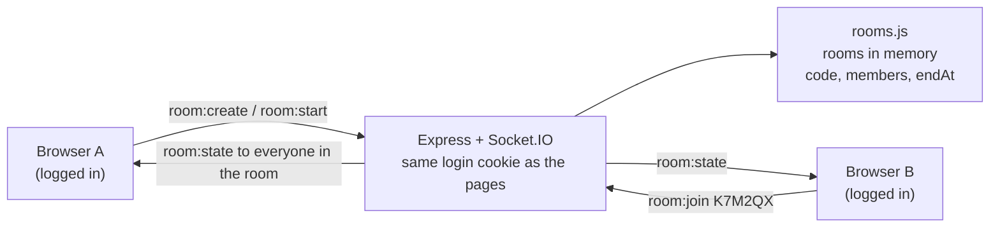

# Study rooms (body doubling)

## The problem

Studying alone makes it easy to put things off. Studying "together" with a friend, even remotely and in silence, helps people start and keep going (body doubling). Focus Tracker had no way to share a timer.

## How it works

- **Socket.IO** runs on the same http server as the pages. It reads the same login cookie (express-session + passport), so only logged-in people can connect; anyone else gets *Log in to use study rooms*.
- **Codes** are 6 letters and numbers without 0, O, 1, I or L, so one read out loud can't be mistyped. Typing `k7m-2qx` works.
- **The server stores `endAt`**, the moment the shared timer ends. Each screen works out the time left from it, so someone joining late sees the same time left as everyone else.
- Rooms live in memory: a restart (a Render deploy) closes them. Nobody's sessions are lost, those are in Postgres.
- Up to 12 people a room, one room at a time each, at most 5 messages a second per person.
- Closing a tab doesn't leave the room at once: after 30 seconds with none of your tabs connected, you leave. A reload puts you straight back.

## Days

| Day | Done |
|---|---|
| Thu 12 Nov | Socket.IO added; make a room (6-character code), join by code, members list, leave; logged-in only; server stores `endAt`. `rooms.js` 15 tests, sockets 4 tests |
| Fri 13 Nov | The shared timer on the page: Start/Pause for everyone, late joiners see the right time left, reconnecting |
