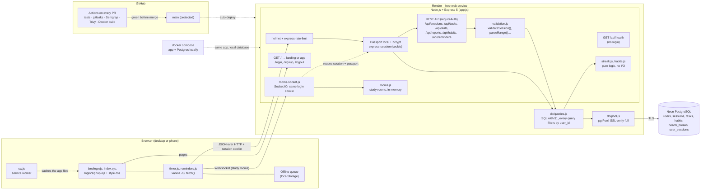
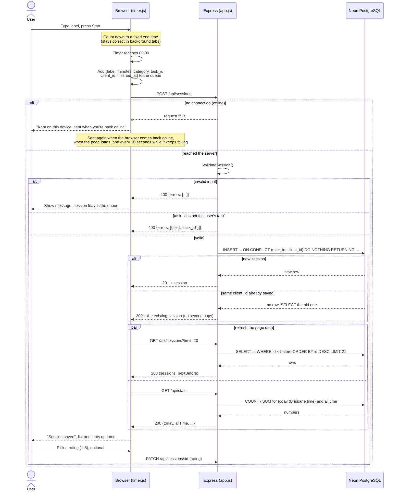
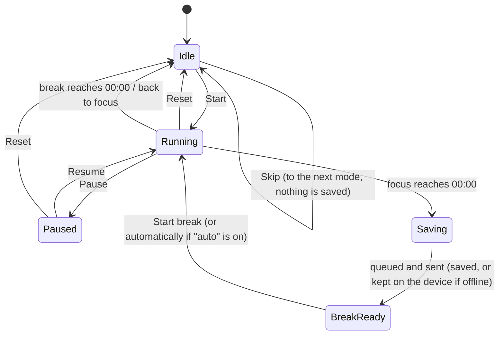

# Focus Tracker – Architecture

Covers accounts, categories, tasks, reports, habits, study rooms, offline sessions, health reminders, CI and Docker. If this file and the code disagree, the code is right: please fix this file.

## 1. Architecture diagram

Components, libraries, servers and APIs, and how they connect.

| Layer | Technology |
|---|---|
| Frontend | HTML (EJS), CSS, vanilla JavaScript, service worker |
| Server | Node.js, Express 5, EJS |
| Realtime | Socket.IO (study rooms) |
| Database access | `pg` (node-postgres), `dotenv` |
| Database | PostgreSQL on Neon (free tier) |
| Hosting | Render (free web service), GitHub for source and deploys |

## 2. Data flow: finishing a focus session

Every finished session goes into a queue on the device first (`localStorage`), with an id made in the browser (`client_id`) and the time it finished (`finished_at`). The queue is then sent to the server. That way a session finished offline is not lost, and a session sent twice is saved once.

## 3. State diagram: the timer

The timer has three modes: focus, short break and long break. After `settings.every` focus sessions the next break is a long one.

`BreakReady` shows the "Nice work" panel with the 1-5 rating. A request that fails because of the connection or a server error does not lose the session: it stays in the queue and is retried. A session the server refuses for good (for example, its task was deleted, or it is too old) is dropped from the queue with a message, so it does not block the sessions behind it.

## 4. Error handling

| Situation | Response |
|---|---|
| Not logged in | `401 { "error": "Please log in" }` |
| Too many requests | `429` (100 per 15 minutes on `/api`, 10 on `/login` and `/signup`, per IP) |
| Bad label or minutes | `400` with field errors |
| Id is not a positive integer | `400` |
| `task_id` is not this user's task | `400` (`Unknown task`) |
| Session id not found, or not yours | `404` |
| The same offline session is sent twice | `200` with the existing session |
| Database or unexpected error | `500` (no SQL details leaked) |
| Neon drops an idle connection | Logged; the pool opens a new connection next time |

## 5. Study rooms

Study rooms are a live shared timer over Socket.IO (`rooms-socket.js`). The socket reads the same login cookie as the pages, so only logged-in users can connect. `rooms.js` holds the room state in the server's memory and the server owns the clock, so rooms are lost on a restart and do not work across several server instances. Details: `docs/study-rooms.md`. Habits and offline sessions are explained in `docs/habits.md` and `docs/offline.md`.
