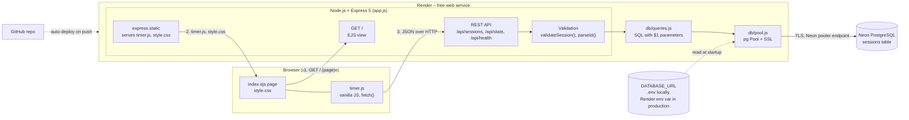
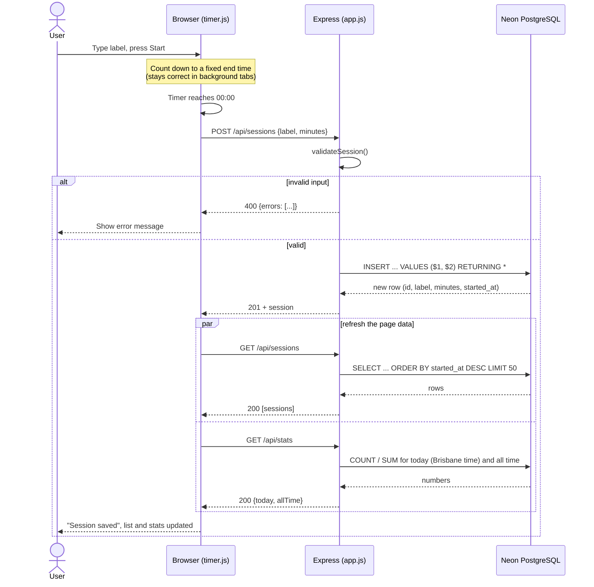
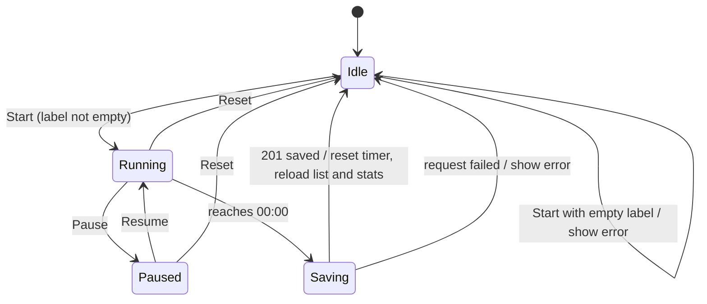

# Focus Tracker – Architecture

## 1. Architecture diagram

Components, libraries, servers and APIs, and how they connect.

| Layer | Technology |
|---|---|
| Frontend | HTML (EJS), CSS, vanilla JavaScript |
| Server | Node.js, Express 5, EJS |
| Database access | `pg` (node-postgres), `dotenv` |
| Database | PostgreSQL on Neon (free tier) |
| Hosting | Render (free web service), GitHub for source and deploys |

## 2. Data flow: finishing a focus session

## 3. State diagram: the timer

## 4. Error handling

| Situation | Response |
|---|---|
| Bad label or minutes | `400` with field errors |
| Id is not a positive integer | `400` |
| Session id not found | `404` |
| Database or unexpected error | `500` (no SQL details leaked) |
| Neon drops an idle connection | Logged; the pool opens a new connection next time |
